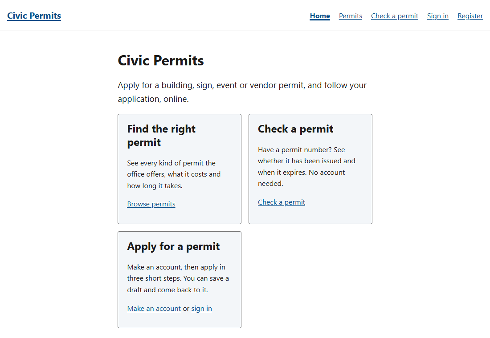
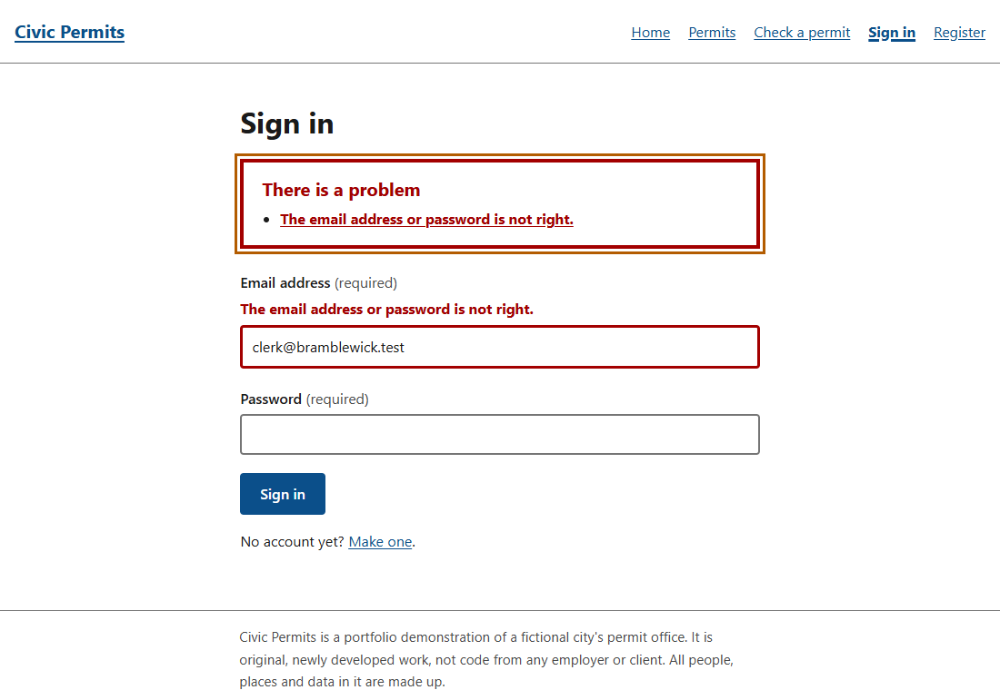
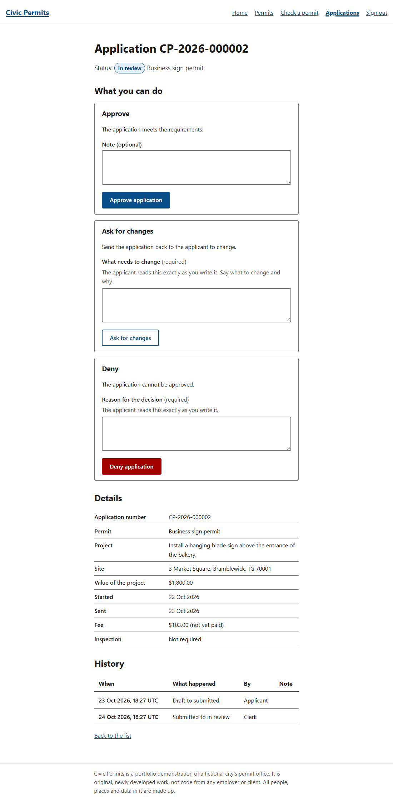
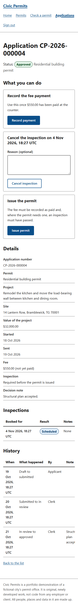

# Civic Permits

[](https://github.com/tsmiley/civic-permits/actions/workflows/ci.yml)
[](https://github.com/tsmiley/civic-permits/actions/workflows/codeql.yml)

An online service for a city permit office, built to show what careful architecture, security and accessibility work
looks like in a realistic .NET 10 application.

Residents and businesses apply for permits (building, sign, event, vendor) in three short steps. Clerks review
applications, ask for changes, and approve or deny, always with a reason the applicant can read. Inspectors record what
they find. Administrators define the permit types and their fees. Anyone can look up a permit's status by its number.



## About this repository

**This is newly developed portfolio work. It is original code written from an empty folder for this
repository. It is not source code from any employer, client or other company, and it was not adapted from any
private project.** The town, people, addresses and permits in the sample data are entirely fictional.

## What it is meant to show

- **A domain that can be read.** The permit office's rules live in a project that depends on nothing, and the whole
  process is one table that tests check against an independent statement of the rules
  ([architecture](docs/ARCHITECTURE.md), [decisions](docs/adr/README.md)).
- **Accessibility as the feature, with honest claims.** Built and tested against WCAG 2.1 AA; the 54 page states
  listed in the report pass the axe-core rules; scripted browser tests cover keyboard, focus, reflow and spacing. It says plainly
  what has *not* been done: no manual screen-reader run is recorded and nothing is certified
  ([report](docs/ACCESSIBILITY_REPORT.md), [procedure](docs/ACCESSIBILITY_TESTING.md)).
- **Security that is designed, tested and written down.** Access decided in one place, errors that reveal nothing,
  sign-in that answers the same, and does the same work, for an unknown address and a wrong password; an API that
  requires a sign-in unless an operation is listed as public; concurrency guarded in the database for applications and
  permit numbers (permit-type edits are last-write-wins)
  ([threat model](docs/THREAT_MODEL.md), [ledger](docs/SECURITY_LEDGER.md)).
- **Two databases.** SQLite by default (nothing to install), SQL Server by configuration, one migration history each, and
  a test that fails when the model and a provider's migrations disagree. Both run in CI on every push: the
  SQLite tests directly, and the SQL Server tests against a Developer-edition container started for the run with a
  password made up for it. On a Windows machine they use LocalDB instead.
- **Discipline you can check.** Warnings are build errors, a vulnerable package fails the restore, every package is
  MIT, Apache-2.0 or BSD apart from reviewed and listed exceptions, and the documentation's diagrams are drawn from the
  code by tests so they cannot drift.

| | |
|---|---|
|  |  |
| A refused form: focus goes to the summary, whose links go to each field | A clerk's page: one small form per step, reasons the applicant will read |

## Quick start

You need the [.NET 10 SDK](https://dotnet.microsoft.com/download/dotnet/10.0) and Git. Nothing else: the
default database is a local SQLite file.

```bash
git clone https://github.com/tsmiley/civic-permits.git
cd civic-permits
dotnet build
dotnet test
```

To run the site with the fictional town's data and sample sign-ins, give it a password. It is yours to choose, it is
read from the environment, and it is never written down:

```bash
export Database__SampleUserPassword="a password of at least fifteen characters"
dotnet run --project src/CivicPermits.Web
```

Open <http://localhost:5211> and sign in as `clerk@bramblewick.test` with that password. The other sample sign-ins are
`applicant.one@bramblewick.test`, `applicant.two@bramblewick.test`, `applicant.three@bramblewick.test`,
`inspector.one@bramblewick.test`, `inspector.two@bramblewick.test` and `administrator@bramblewick.test`. The addresses
use the reserved `.test` domain, so they can never reach a real mailbox. Without a password the data loads but nobody
can sign in.

The REST API runs separately: `dotnet run --project src/CivicPermits.Api` at <http://localhost:5210>, with its OpenAPI
document at `/openapi/v1.json` in Development ([API guide](docs/API.md)).

To use SQL Server instead of SQLite (the free LocalDB edition works):

```bash
export Database__Provider=SqlServer
export Database__ConnectionString="Server=(localdb)\\MSSQLLocalDB;Database=CivicPermits;Trusted_Connection=True;TrustServerCertificate=True"
```

The browser tests drive the Chrome or Edge already installed on your machine (nothing is downloaded); with none they
skip, saying so.

## Documentation

| Read | For |
|---|---|
| [docs/ARCHITECTURE.md](docs/ARCHITECTURE.md) | The projects and the one rule, how a request travels, the data, the workflow diagram, how it is tested |
| [docs/adr/](docs/adr/README.md) | Eleven short records of the decisions that shaped it, with what was rejected |
| [docs/API.md](docs/API.md) | Signing in, the error format, who can do what, with `curl` examples |
| [docs/ACCESSIBILITY_REPORT.md](docs/ACCESSIBILITY_REPORT.md) | What was tested, what was found, all 50 WCAG 2.1 A and AA criteria with an honest status for each, and the gaps |
| [docs/ACCESSIBILITY_TESTING.md](docs/ACCESSIBILITY_TESTING.md) | The automated tests and the manual procedure |
| [docs/MANUAL_CHECK_NARRATOR.md](docs/MANUAL_CHECK_NARRATOR.md) | A twenty-minute screen-reader check anyone can do on Windows, with a table to fill in |
| [docs/THREAT_MODEL.md](docs/THREAT_MODEL.md) | What is protected, from whom, and what is done and not done |
| [docs/DEPLOYMENT.md](docs/DEPLOYMENT.md) | Configuration, migrations, running behind a proxy, and what is not production-ready |
| [docs/SECURITY_LEDGER.md](docs/SECURITY_LEDGER.md) | Findings and incidents, with their fixes |
| [CONTRIBUTING.md](CONTRIBUTING.md), [SECURITY.md](SECURITY.md), [CHANGELOG.md](CHANGELOG.md) | How the work is done, how to report a problem, what changed |

## The people who use it

| Who | What they can do |
|---|---|
| Anyone | Browse the permits and their fees, look up a permit by number, register, sign in |
| Applicants | Start an application in three steps (choose, describe, check and send), change a draft or one sent back, withdraw, follow the history |
| Clerks | See every application, start a review, approve, deny or ask for changes (with a reason the applicant reads), record the fee payment, book and cancel inspections, issue the permit |
| Inspectors | See the applications they are booked to inspect and record the result |
| Administrators | Everything a clerk can do, plus define, change, open and close permit types |



The pages work without JavaScript and reflow to a 320 px screen; the small scripts only improve where focus goes.

## The projects

| Project | Responsibility |
|---|---|
| `CivicPermits.Domain` | Entities, value objects, rules and the workflow table. Depends on nothing. |
| `CivicPermits.Application` | Use cases as request handlers behind a small dispatcher; the contracts the outside must satisfy. |
| `CivicPermits.Shared` | Plain contracts shared by the API and its clients. |
| `CivicPermits.Infrastructure` | EF Core (SQLite and SQL Server), ASP.NET Core Identity, sample-data seeding, and the hosting both web hosts share. |
| `CivicPermits.Migrations.Sqlite`, `.SqlServer` | One migration history per database provider. |
| `CivicPermits.Api` | The REST API: problem-details errors, health checks, OpenAPI. |
| `CivicPermits.Web` | The Blazor web site: server-rendered pages, accessibility built in. |

Tests: `Domain.Tests` and `Application.Tests` (unit), `Infrastructure.Tests` (migrations, seeding and constraints
against real SQLite and real SQL Server: a container in CI, LocalDB on Windows), `Api.IntegrationTests` (the real API in memory),
`Web.IntegrationTests` (the real site in memory: cookies, sign-in, caching, headers), `Web.A11yTests` (a real browser
driving the running site, including the axe-core sweep). Run each project in turn:

```bash
for project in Domain.Tests Application.Tests Infrastructure.Tests Api.IntegrationTests Web.IntegrationTests Web.A11yTests; do
  dotnet test "tests/CivicPermits.$project"
done
```

## Known limits

This is a portfolio demonstration, not a deployed service. The honest list is in
[docs/DEPLOYMENT.md](docs/DEPLOYMENT.md#what-is-not-production-ready) and
[docs/ACCESSIBILITY_REPORT.md](docs/ACCESSIBILITY_REPORT.md#5-known-gaps-and-what-remains); the main points are: no email
(so no confirmation, reset or notifications), no payment, no multi-factor sign-in, a session that ends silently after eight
hours, times in UTC, and no manual assistive-technology testing recorded yet.

## Licence

MIT, see [LICENSE](LICENSE). Third-party packages are listed in [NOTICE](NOTICE), including axe-core, which is MPL-2.0
and is used unmodified for tests only.
