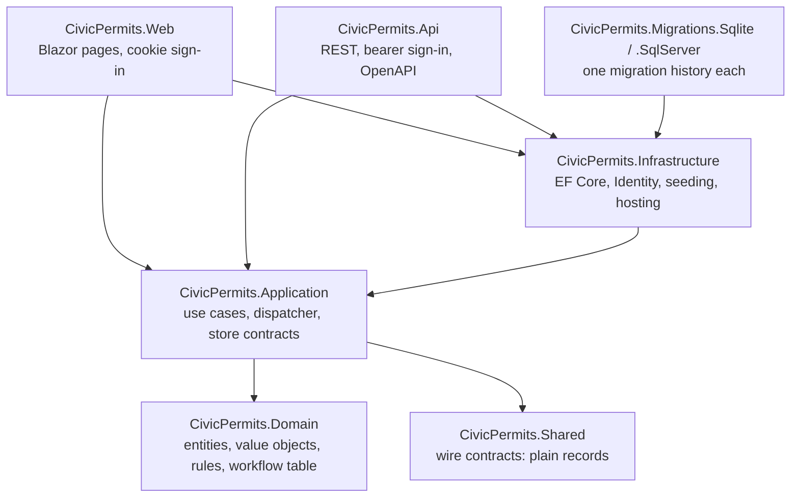
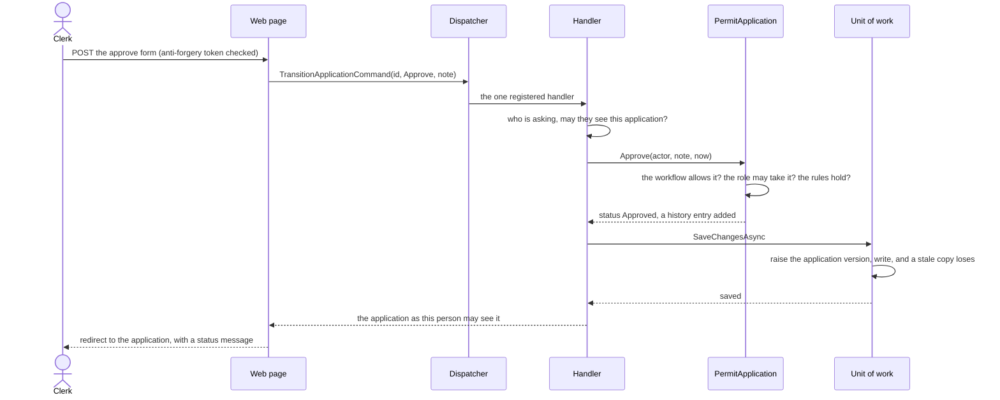
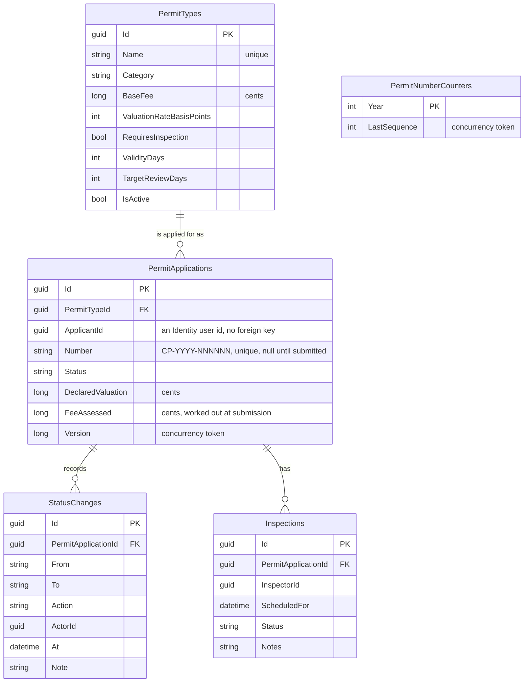
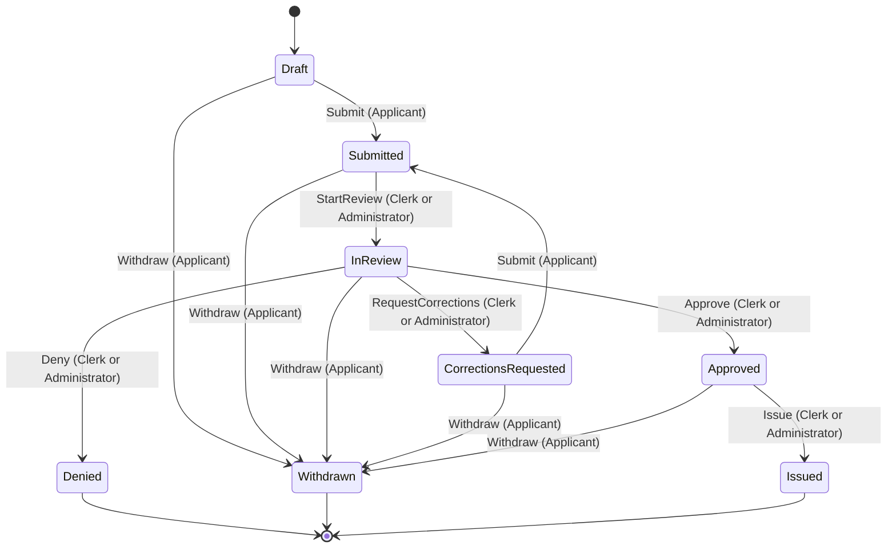

# Architecture

Civic Permits is one solution of small projects. This page is the map: what is where, which way dependencies point,
how a request travels, what the data looks like, and the one table that decides what may happen to an application.
Decisions and their reasons are in [adr/](adr/); the security design is in [THREAT_MODEL.md](THREAT_MODEL.md).

## The projects and the one rule

Dependencies point inward. The domain depends on nothing, so the rules of the permit office can be read, tested and
changed without a web server, a database or a framework in sight.

| Project | What it holds | What it must never do |
|---|---|---|
| `Domain` | `PermitApplication` (the aggregate root), `PermitType`, `Inspection`, `StatusChange`; `Money`, `PostalAddress`, `PermitNumber`; the workflow table; rule violations with stable codes | Reference any package, project, clock or database |
| `Application` | One request type and one handler per use case; a 40-line dispatcher; the contracts the outside must satisfy (`IPermitApplicationStore`, `IUnitOfWork`, `ICurrentUser`, `IPermitNumberAllocator`, `IUserDirectory`); who may see what (`Access.cs`) | Know about HTTP, EF Core or Identity |
| `Shared` | The records sent over the wire, shared by the API and its clients | Contain behaviour |
| `Infrastructure` | EF Core mapping, stores, the number allocator, Identity bootstrapping, sample data, and the hosting both web hosts share (logging, correlation id, security headers, rate limiting, health checks) | Hold a business rule |
| `Migrations.*` | The migration history for one database provider | Reference anything but Infrastructure |
| `Api` | Endpoints, bearer-token sign-in, problem-details mapping, OpenAPI | Decide anything: it asks the application layer |
| `Web` | Pages, shared form components, cookie sign-in, focus management | Decide anything: it asks the application layer |

## How a request travels

A clerk approves an application on the web site. The API takes the same path from the endpoint inward.

Every method on the aggregate checks the same things in the same order: first, for an applicant, that the application
is theirs (a stranger gets the same refusal whatever the status, so the answer says nothing about the application);
then that the workflow allows the step; then that the person's role may take it; then the rules specific to the step.
Withdrawing an application or issuing its permit also cancels any inspection still scheduled, so no open inspection
outlives the decision. A step that fails changes nothing and writes no history. Time is always passed in, never read from a
clock, so any rule can be tested at any moment.

## What a failure looks like

Two kinds of failure are expected and carry a stable `code`; anything else is a bare 500 that names nothing.

| Failure | Raised by | API answer | Web answer |
|---|---|---|---|
| A broken rule (`DomainRuleException`) | The domain | 403, 404, 409 or 422 problem document, by the rule | The message at the field, with an error summary |
| A request that cannot proceed (`RequestException`) | The application layer | 401, 403, 404 or 409 problem document | A not-found page, or the message on the page |

An application that someone may not see is reported as not found, never as forbidden, so an answer cannot confirm
that an identifier is real.

## The data

SQLite is the default and needs nothing installed; SQL Server (LocalDB works) is the other supported provider. Money
is stored as whole cents, every moment as UTC, and enums as text. There is no foreign key from an application to its
applicant, because the domain does not know about Identity (see [adr/0010](adr/0010-no-foreign-key-from-an-application-to-its-applicant.md)).

The Identity tables (users, roles, role assignments) sit beside these. The four roles are `Applicant`, `Clerk`,
`Inspector` and `Administrator`, spelled exactly as the domain's `ActorRole`, so a role claim maps straight onto the
role the domain checks.

## The workflow

The whole process is one table in `ApplicationWorkflow`. The application asks the table what may happen next; the
tests check the table against a separately written statement of the rules and then drive the real aggregate through
every status, action and role (576 combinations); and the diagram below is drawn from the table by a test, so it
cannot drift. Regenerate it with `CP_UPDATE_DOCS=1 dotnet test tests/CivicPermits.Domain.Tests --filter DocumentationTests`.

Two rules sit beside the table and are not edges in it: a permit is issued only once the fee is recorded as paid and,
when the permit type needs one, the latest inspection has passed; and denying or asking for corrections needs a reason
the applicant can read.

<!-- workflow-diagram:start -->

<!-- workflow-diagram:end -->

## Cross-cutting behaviour

| Concern | Where | What it does |
|---|---|---|
| Correlation id | `CorrelationIdMiddleware` | Every response carries `X-Correlation-Id`; every log line and every problem document carries it |
| Security headers | `SecurityHeadersMiddleware` | A content security policy (none for the API; scripts and styles from the site itself only, no inline, for the web site), `nosniff`, no framing, a strict referrer policy, a permissions policy |
| Rate limiting | `RateLimiting.cs` | Per-address limits on sign-in, registration and the public lookup; a global per-person or per-address limit; `429` with `Retry-After` |
| Concurrency | `CivicPermitsDbContext` | A version on every application, raised on any change including a new history entry; a stale write is a 409 |
| Permit numbers | `PermitNumberAllocator` | A per-year counter saved in the same transaction as the submission: no duplicates, no number used up by a failed request |
| Health | `/health/live`, `/health/ready` | Live runs no checks; ready needs the database. Neither says more than a status word |
| Configuration | Options validated at start | A missing or malformed setting stops the host with a clear message, not the first request |

## How it is tested

| Project | Kind | What it proves |
|---|---|---|
| `Domain.Tests` | Unit | The rules, the value objects, and the workflow table against an independent specification; the diagrams in these documents |
| `Application.Tests` | Unit | The dispatcher, including a handler that throws before it returns and a request that is two kinds of request |
| `Infrastructure.Tests` | Real databases | Migrations on SQLite and on SQL Server (a container in CI, LocalDB on Windows), that the model and migrations agree, seeding, constraints, concurrency |
| `Api.IntegrationTests` | The real API in memory | Sign-in, every endpoint, authorization (including the exact list of public operations), error documents and their status mapping, rate limits, caching and security headers, refusal logging, token expiry, OpenAPI |
| `Web.IntegrationTests` | The real site in memory | Session and anti-forgery cookies, sign-in and lockout, the same answer for a wrong password and an unknown address, return-address handling, caching and `Clear-Site-Data`, 403 and 404 behaviour, the content security policy |
| `Web.A11yTests` | A real browser on the real site | Whole journeys, keyboard use, reflow, and the axe-core sweep; the headers real Kestrel sends; see [ACCESSIBILITY_TESTING.md](ACCESSIBILITY_TESTING.md) |
